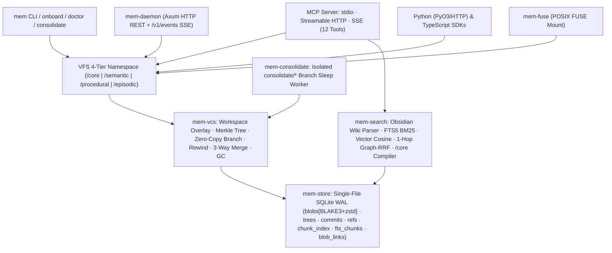

<div align="center">

# Engram (`mem`)

**Git-like Versioned Structured Memory Engine for AI Agents**

Single-file SQLite BLAKE3 CAS &bull; Merkle Tree Branching & Rewind &bull; Obsidian `[[Wikilink]]` Graph Hybrid Search &bull; Built-in MCP Server

[](https://github.com/z23ng/engram/actions/workflows/ci.yml)
[](https://github.com/z23ng/engram/actions/workflows/release.yml)
[](./LICENSE-MIT)
[](./Cargo.toml)
[](./docs/USER_GUIDE.md)

[完整使用说明手册](./docs/USER_GUIDE.md) &bull; [系统架构设计](./docs/ARCHITECTURE.md) &bull; [部署与运维指南](./docs/DEPLOYMENT.md) &bull; [实战示例](./examples/) &bull; [路线图](./docs/ROADMAP.md)

</div>

---

**Engram (`mem`)** 是受 `Ephemeral-AI-Lab/layerfs` 启发的**面向 AI Agent 的版本化结构记忆引擎**。它将不可变内容寻址存储（BLAKE3 CAS + zstd）、Merkle Tree 分支版本控制与 Obsidian 双链知识图谱融合检索装进**单个本地 SQLite 文件**，让 Agent 记忆真正支持：

- **亚毫秒零拷贝分支（`mem branch`）**：多 Subagent 隔离试错，互不污染；
- **防幻觉瞬间回滚（`mem rewind`）**：写错记忆一键时间旅行回到健康 Commit；
- **Obsidian Wiki 级高命中率（`mem search`）**：YAML 别名高权 + 标题面包屑切片 + 1-Hop `[[Wikilink]]` 出链/反向链接扩散；
- **零外部强依赖 & 双模热切换**：单 `.db` 开箱即用，本地用 Ollama，上生产一行 `mem config use openai` 无缝切换。

---

## 30 秒快速开始

### 一行命令安装 & 启动现代引导向导

```bash
curl -fsSL https://raw.githubusercontent.com/z23ng/engram/main/install.sh | sh
```

安装器自动匹配平台二进制并启动 **`mem onboard`** 向导——自动探测本机硬件（CPU / RAM / GPU / Ollama）、持久化配置到 `~/.ai-memory/config.json`（告别手动 `source env`），并将 MCP 服务无损自动注入 **Cursor / Claude Code / Claude Desktop / Windsurf**：

```text
┌  Engram (`mem`) — Interactive Setup
│  Git-like Versioned Memory + Obsidian Wiki Graph + MCP
│
◇  Host & Hardware Discovery
│  ├─ System   : linux / x86_64 (16 threads, 15.6 GiB RAM)
│  ├─ GPU      : NVIDIA GeForce RTX 4080 SUPER, 16376 MiB
│  ├─ Ollama   : online at 127.0.0.1:11434
│  └─ Agents   : Cursor, Claude Code
│
◇  ollama Profile saved: ~/.ai-memory/config.json -> bge-m3 + qwen2.5:7b
│
◇  Memory Vault Initialized ~/.ai-memory/memory.db
│  ├─ Root     : main (ce701e70efa3)
│  └─ Starter  : seeded 4 Obsidian Wiki notes & committed snapshot
│
◇  MCP Agent Auto-Wiring
│  ├─ Cursor                 merged (~/.cursor/mcp.json)
│  ├─ Claude Code            merged (~/.claude.json)
│  └─ Universal MCP Snippet  created (~/.ai-memory/mcp_config.json)
│
◇  Live Verification Passed
│  ├─ /core Compiler : 0.13ms (44 tokens, target < 5.00ms)
│  └─ 1-Hop Search   : "BUSY_TIMEOUT" -> 3 linked notes in 0.48ms
│
└  Engram is ready! No env sourcing needed — config is auto-loaded.
```

---

## 核心特性与实测表现

| 能力维度 | 传统扁平 RAG / 外部黑盒记忆库 | Engram (`mem`) 架构优势 |
| :--- | :--- | :--- |
| **Markdown / Obsidian 命中率** | 切块后丢失主语与引用关系，别名搜不到 | **YAML `aliases`/`tags`/`entities` + 标题面包屑切片 + 1-Hop `[[Wikilink]]` 出链/反向链接扩散**（实测 `"BUSY_TIMEOUT"` 0.48ms 召回卡片与关联 SOP） |
| **记忆污染与回滚** | 原地覆写向量库，幻觉写入后难以清除 | **BLAKE3 CAS 不可变对象 + `mem rewind` 原子指针回滚**，配合 `mem gc` 清理孤儿 Blob 与 FTS5 行 |
| **多 Agent 并行探索** | 共享同一可写表，Subagent 互相覆盖 | **零拷贝分支（10,000 节点库实测 `< 1ms`，0 字节增量）** + 严格分支隔离检索 + Merkle 剪枝 `diff` / 三路 `merge` |
| **热路径延迟与索引复用** | 每次写记忆调 LLM（秒级），多分支重复算向量 | **热路径零 LLM 调用**；`/core` 编译实测 `0.13ms–0.24ms`；50 个分支共享相同文档时 **仅触发 1 次 Embedding 计算** |
| **开发→生产无缝切换** | 需要各自维护两套脚本与环境变量 | `mem config use ollama`（本地免费） $\leftrightarrow$ `mem config use openai --api-key sk-...`（生产云端） |

---

## 系统架构与四层认知空间



- **`/core/`**：高优先级核心约束与当前目标，每次请求经 `mem compile` 在 `<5ms` 内确定性注入 System Prompt。
- **`/semantic/`**：结构化知识卡片与实体关系，支持 Obsidian Frontmatter、`[[Wikilinks]]` 与版本修订。
- **`/procedural/`**：操作剧本（SOP）与报错排查指南，通过双链与 `/semantic/` 互引。
- **`/episodic/`**：按会话与时间线归档的轨迹日志。

---

## 常用指令速览

```bash
# 1. 模型档案热切换（Ollama 本地开发 <-> OpenAI 生产 <-> Lite 纯 CPU）
mem config use ollama
mem config use openai --api-key "sk-..."
mem config show

# 2. PM + Dev + Bot 协同知识库：初始化模板、双向同步/导出 & 口语草稿自动织链
mem vault init-template ./team-vault
mem vault sync ./team-vault --branch main --commit
mem ingest --role pm --draft --title "Checkout Retry Rule" "All retries obey SQLite WAL busy_timeout."
mem diff main draft/pm-inbox && mem merge draft/pm-inbox main
mem vault export ./team-vault --branch main

# 3. 导入单个目录的 Obsidian Vault 并检索
mem vault import ./examples/obsidian-vault --branch main --tier semantic --commit
mem search "BUSY_TIMEOUT"

# 4. 多分支试错、对比、合并与防污染回滚
mem branch exp/opt --from main
mem write --branch exp/opt /procedural/tip.md "Set PRAGMA busy_timeout = 5000"
mem diff main exp/opt
mem merge exp/opt main
mem rewind <healthy_commit_id>

# 5. 一键运行多 Agent 分支合并实战示例
./examples/multi_agent_branch_merge.sh

# 6. 冷路径睡眠整理、多项目/单库 Web 服务端与 POSIX FUSE 挂载
mem consolidate --auto-merge --archive --delete-branch
mem serve --data ~/.engram/server --listen 127.0.0.1:7878   # 多项目 React/CodeMirror/Graph 控制台 + WebDAV
mem daemon --host 127.0.0.1 --port 7700                     # 单库 REST/SSE/图谱/零依赖 Web 控制台
mem mount /tmp/engram-mnt --branch main
```

---

## 仓库结构

```text
engram/
├── crates/
│   ├── mem-core/        # 纯领域模型：VirtualPath、MemoryNode、BLAKE3 IDs、VCS 类型
│   ├── mem-store/       # SQLite WAL 存储引擎：BLAKE3+zstd CAS、Merkle Tree、FTS5 与图谱表
│   ├── mem-vcs/         # 版本控制内核：工作区叠加、分支、Diff、Rewind、3-Way Merge、GC
│   ├── mem-search/      # Obsidian Wiki 解析、Ollama/OpenAI 向量、1-Hop 图谱混合检索与图谱导出、/core 编译
│   ├── mem-consolidate/ # 冷路径睡眠整理：在隔离 consolidate/* 分支扫描 /episodic 提炼卡片与 SOP
│   ├── mem-mcp/         # 协议无关 JSON-RPC 2.0 MCP 核心工具分发器
│   ├── mem-server/      # 多项目团队服务端 (`mem serve`)：控制面、RBAC/审计、WebDAV 与内嵌 React UI
│   ├── mem-daemon/      # 单库轻量 HTTP REST / SSE / 零依赖 Web UI / 双模 MCP 守护进程 (`mem daemon`)
│   ├── mem-fuse/        # POSIX FUSE 挂载适配器（支持目录直接读写与只读快照挂载）
│   └── mem-cli/         # `mem` 二进制：全量 CLI、引导向导、`serve`/`admin`、`consolidate`、`daemon`、`mount` 与 stdio MCP
├── web/                 # React 19 + TypeScript + Tailwind + CodeMirror + Knowledge Graph 控制台源码
├── bindings/            # 原生 Python (PyO3 + HTTP/SSE) 与 TypeScript (@engram-memory/sdk) SDKs
├── examples/            # 开箱即用的 Obsidian Vault 示例、多 Agent 脚本及 Python/TS 示例
├── docs/                # 使用手册、架构设计、部署运维、[多项目服务端设计 (SERVER_DESIGN.md)](./docs/SERVER_DESIGN.md)与路线图
├── install.sh           # 一行远程安装脚本 (支持预编译二进制与源码回退)
├── Dockerfile           # 多阶段生产容器与 docker-compose.yml
└── .github/workflows/   # CI 自动化测试（Rust、Fmt/Clippy、React Web、Python/TS SDK）与 Release 发布流水线
```

---

## 文档与工程规范

| 文档 | 说明 |
| :--- | :--- |
| [**完整使用说明手册 (docs/USER_GUIDE.md)**](./docs/USER_GUIDE.md) | 安装向导、Obsidian Wiki 规范、全 CLI 命令参考、实战 Recipes 与 FAQ |
| [部署与运维指南 (docs/DEPLOYMENT.md)](./docs/DEPLOYMENT.md) | 多平台部署、Ollama→OpenAI 切换、Docker 编排与 MCP 接入 |
| [系统架构设计 (docs/ARCHITECTURE.md)](./docs/ARCHITECTURE.md) | 分层架构、ER 模型、Graph-RRF 检索流程与三路合并策略 |
| [目录结构与模块规划 (docs/DIRECTORY_STRUCTURE.md)](./docs/DIRECTORY_STRUCTURE.md) | Cargo Workspace 职责划分与核心 Trait 接口 |
| [开发路线图 (docs/ROADMAP.md)](./docs/ROADMAP.md) | M1–M4 里程碑与验收标准 |
| [贡献指南 (CONTRIBUTING.md)](./CONTRIBUTING.md) & [安全策略 (SECURITY.md)](./SECURITY.md) | 五大架构不变量、离线测试流程与安全规范 |

---

## License

Dual-licensed under [MIT](./LICENSE-MIT) or [Apache-2.0](./LICENSE-APACHE), at your option.
