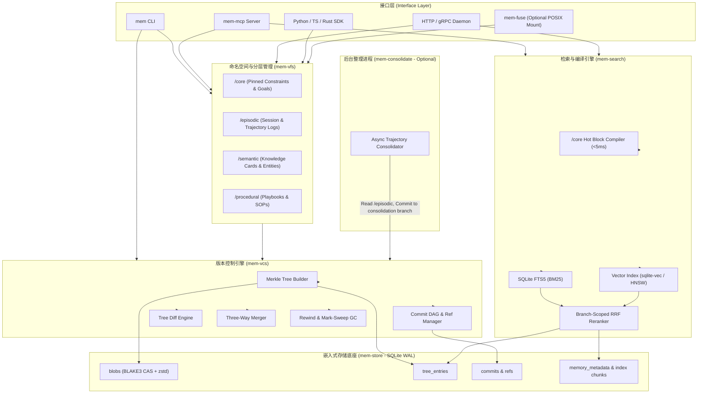
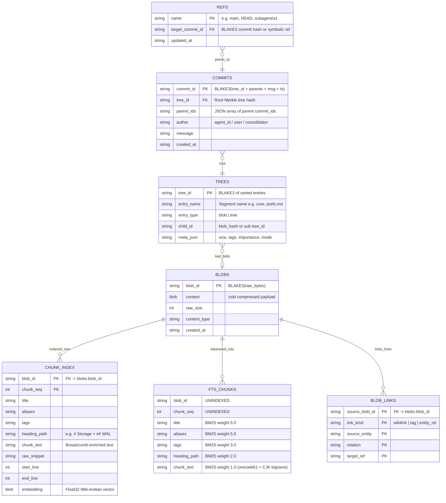
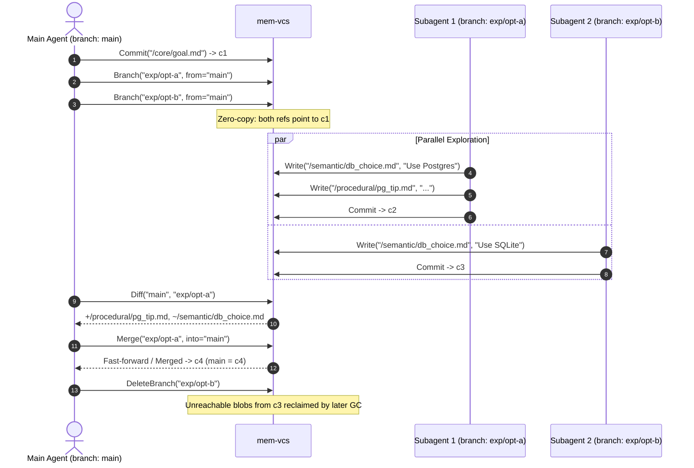
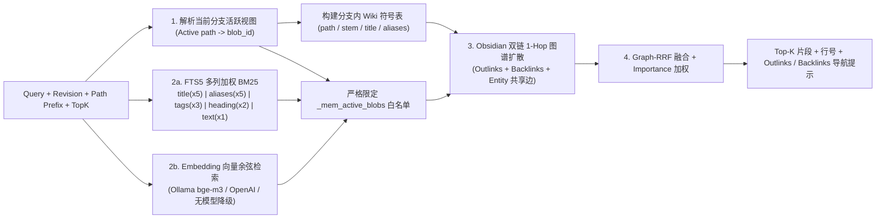

# AI Memory (`mem`) 系统架构设计

本文档阐述 `ai-memory` 的系统分层架构、VFS 记忆命名空间、基于 SQLite 的 CAS 与 Merkle Tree 版本控制模型、分支感知混合检索引擎及核心操作时序。

---

## 1. 总体分层架构

---

## 2. VFS 记忆命名空间与分层设计（`mem-vfs`）

参考认知科学记忆分类与 `LayerFS` 目录树隐喻，每条记忆节点均为一个携带 Frontmatter 元数据与正文内容的虚拟文件（推荐 Markdown + YAML/TOML 元数据或结构化 JSON）：

| 路径前缀 | 记忆层级 | 生命周期与读写特征 | 典型用途 |
| :--- | :--- | :--- | :--- |
| `/core/` | 核心工作记忆 | 极小体积（受 Token 预算约束），低频修改，每次请求热路径直出 | Agent 人设、硬性规则约束、当前项目栈、活跃任务目标 |
| `/episodic/` | 情景轨迹记忆 | 只追加（Append-only）或按 Session/Date 分片归档 | 历史会话摘要、工具调用成败轨迹、外部环境观测事件 |
| `/semantic/` | 语义知识记忆 | 结构化实体卡片，随版本持续修订覆写与消解冲突 | 架构决策记录、用户偏好档案、业务领域术语与实体关系 |
| `/procedural/` | 程序性技能记忆 | 面向任务类型索引，支持置信度评分与命中次数衰减 | Debug 经验、特定代码库操作 SOP、工具调用避坑指南 |

每个节点自动携带版本控制元数据：`path`、`blob_hash`、`content_type`、`importance_score`、`tags`、`created_at`、`updated_at`、`source_commit`。

---

## 3. SQLite CAS 与 Merkle Tree 存储模型（`mem-store`）

受 `LayerFS` 的单库 CAS 设计启发，整个记忆库完全持久化于**单个 SQLite 数据库文件**（开启 `WAL` 模式与外键约束）。

### 3.1 实体关系模型（ER Diagram）

### 3.2 关键设计优势
1. **全局去重与零拷贝 Branch**：`blobs` 和 `trees` 只按内容哈希存储。创建一个新分支仅需向 `refs` 表插入一行指向同一 `commit_id` 的记录，**耗时 < 0.1ms，存储增量 0 字节**。
2. **索引内容寻址化（Deduplicated Indexing）**：`CHUNK_INDEX`（FTS5 文本片段与 Embedding 向量）挂载在不可变的 **`blob_id`** 上而非可变的 `path` 上！这意味着：
   - 同一份记忆文件在 100 个分支中共存时，**只需计算一次 Embedding 和分词索引**。
   - 查询时只需先获取当前 Branch 目标 Commit 的活跃 `blob_id` 集合（或通过物化视图表 `branch_active_blobs(branch, path, blob_id)` 加速），再执行 `WHERE blob_id IN (...)` 过滤，即可实现**毫秒级、零脏数据泄漏的分支隔离检索**。

---

## 4. 核心版本控制与检索流程

### 4.1 多 Agent 并行探索：`branch -> write -> diff -> merge`

### 4.2 记忆污染瞬间回滚（Rewind）与 Staging 工作区

为了兼顾频繁微调的灵活性与版本库整洁性，系统区分 **Working Workspace（未提交暂存区，按 Branch 隔离）** 与 **Committed Snapshot**：
- Agent 每次写入（`mem_write`）默认进入当前分支的 Working Workspace，即时对当前分支的读取与混合检索可见。
- 关键节点触发 `mem_commit(message)` 生成不可变 `commit_id`。
- 当发现某轮对话或工具执行写入了错误记忆时：
  - `mem_rewind(branch, to_commit)`：原子重置分支指针并丢弃脏暂存区；所有被该分支遗弃的后续记忆瞬间“消失”，不留任何污染痕迹。

### 4.3 三路合并策略（Three-Way Merge）

当将分支 `feature` 合并入 `target` 时，基于最近公共祖先（LCA）Commit 的 Merkle Tree 对比三棵树（`base`、`ours`、`theirs`）：
1. **无冲突自动合并**：仅单侧新增/修改/删除的路径直接自动合并（由于采用 Merkle Tree，未变更的子树哈希相等可直接 $O(1)$ 跳过）。
2. **结构化冲突标注**：同一路径在双侧均被修改且哈希不同时：
   - **Append-only 路径（如 `/episodic/`）**：支持按时间戳自动合并追加。
   - **同路径覆写冲突（如 `/semantic/`）**：在合并结果中输出明确冲突标识或触发冲突策略（`ours` / `theirs` / `manual_resolve` / 可选语义合并回调）。

---

## 5. 分支感知混合检索与 Obsidian Wiki 图谱引擎（`mem-search`）

为了克服纯切片 RAG 的“碎纸机效应”和词汇鸿沟，系统将 **Obsidian Wiki 双链图谱** 与 **Mem0 式原子事实/实体关系** 融合于不可变 `blob_id` 之上：

1. **Obsidian 结构解析与面包屑切片（`wiki.rs`）**：
   - 解析 YAML Frontmatter 中的 `title`、`aliases`（同义词/缩写）、`tags`、`entities`（如 `"SQLite -> uses -> WAL Mode"`）与 `importance`。
   - 自动抽取正文中的 `[[Wikilinks]]`、`[[target|alias]]`、`[[target#section]]` 与行内 `#tags`（自动跳过代码块与行内代码）。
   - 切分 Chunk 时自动前置注入结构化面包屑头部：`[Title: ... | Aliases: ... | Tags: ... | Section: # H1 > ## H2]`，确保每个切片在 BM25 与向量空间均保留完整上下文锚点。
2. **四路分支感知 Graph-RRF 混合检索（`hybrid.rs`）**：

- **热路径（`/core/` Compiler）**：读取当前 Branch `/core/` 下全部节点，按 `(importance DESC, path ASC)` 与 `max_tokens` 预算确定性拼接为 `<core_memory>` 上下文块，耗时 **< 5ms**，全程零 LLM 调用。
- **本地 Obsidian 知识库导入（`vault.rs`）**：`import_vault` 自动跳过 `.obsidian/` 等隐藏目录，将本地 `.md` 知识库批量导入目标分支并构建双链图谱与混合索引。

---

## 6. 统一 OpenAI 兼容模型配置（本地 Ollama 开发 / OpenAI 生产切换）

系统所有向量化（Embedding）与冷路径记忆提炼（Consolidation LLM）均采用统一的 **OpenAI-Compatible HTTP 协议**，并内置三级渐进降级能力：

| 运行档位 / 场景 | Embedding 配置 (`EmbeddingProviderConfig`) | 冷路径 Mem0 提炼 LLM (`ConsolidateLlmConfig`) | 适用说明 |
| :--- | :--- | :--- | :--- |
| **Level 1：纯本地零模型降级** | `ProviderBackend::Disabled` (`NoopEmbedder`) | `ProviderBackend::Disabled` | 零外部进程与显卡要求，靠多列加权 FTS5 + Obsidian `[[双链]]` 1-Hop 图谱即可精准召回 |
| **开发 / 离线本地部署 (Ollama)** | `backend = "ollama"` `base_url = "http://127.0.0.1:11434/v1"` `model = "bge-m3"` (`dimensions = 1024`) | `backend = "ollama"` `base_url = "http://127.0.0.1:11434/v1"` `model = "qwen2.5:7b"` | 本地 RTX GPU / Apple Silicon 离线免费运行，默认开发环境预设（`MemConfig::ollama_dev()`） |
| **生产环境部署 (OpenAI API)** | `backend = "openai"` `base_url = "https://api.openai.com/v1"` `model = "text-embedding-3-small"` (`dimensions = 1536`) | `backend = "openai"` `base_url = "https://api.openai.com/v1"` `model = "gpt-4o-mini"` | 生产环境零本地显存占用，仅需切换配置或设置环境变量（`MemConfig::openai_prod(key)`） |

环境变量无缝切换方式：
- 本地开发（默认）：`MEM_PROVIDER=ollama`
- 上线生产：`MEM_PROVIDER=openai` + `OPENAI_API_KEY=sk-...`（可选 `MEM_EMBEDDING_MODEL`、`MEM_EMBEDDING_DIMENSIONS`、`MEM_LLM_MODEL` 覆盖默认值）
